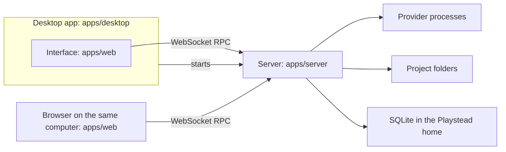

# Architecture

Playstead's first working slice is built in T3 Code's structure. [Following T3 Code](t3-code.md) holds the rules and the weekly review, and [ADR 0001](adr/0001-follow-t3-code.md) records the decision to follow T3 Code and adopt its stack. This document maps T3 Code's structure onto Playstead's and records where Playstead's differs.

T3 Code paths are cited at [`2577baf`](https://github.com/pingdotgg/t3code/tree/2577baf8b0dc541283fa93d6919b0e354effadf4), the commit Playstead followed when this was written; [the weekly review](t3-code.md#the-weekly-review) moves it. Playstead's code goes at the same paths, so each cited path also says where Playstead's version belongs. Terms are T3 Code's, from its `docs/internals/glossary.md`.

## How the parts fit

The server owns everything that touches the machine: projects and their files, provider processes and the database. Clients show its state and send it commands (`docs/internals/overview.md`).

Inside the server, orchestration, persistence and recovery follow T3 Code's (`docs/orchestration-v2/`). The orchestrator (`apps/server/src/orchestration-v2/Orchestrator.ts`) decides events from commands without I/O. The event sink (`EventSink.ts`) commits the events, projections, command receipt and outbox effects in one transaction. The effect worker (`EffectWorker.ts`) then starts provider turns. In T3 Code it also captures checkpoints, hidden Git refs kept by `apps/server/src/checkpointing/`. Playstead's version control waits for its own slice, which chooses the system, so a project is a plain folder and no checkpoints are captured, as T3 Code captures none in a folder that is not a Git repository (`CheckpointService.ts`). Each provider's protocol stays behind its adapter. Server features are Effect services that thin transports call (`docs/internals/effect-services.md`).

Playstead's database starts at its own first migration in `apps/server/src/persistence/`. T3 Code's migration history and its importer for older databases (`apps/server/src/orchestration-v2/legacy/`) are not carried.

## Workspaces

Each workspace sits at the path of the T3 Code workspace it follows, under Playstead's own package name; the spec sets the names.

| Path                                                      | Holds                                                                                                                                                                                                                                                                                                                                      |
| --------------------------------------------------------- | ------------------------------------------------------------------------------------------------------------------------------------------------------------------------------------------------------------------------------------------------------------------------------------------------------------------------------------------ |
| `apps/server`                                             | The server: RPC, orchestration, persistence, providers and checkpoints. Its entry, `src/bin.ts`, runs it for the desktop app or, in development, for a browser.                                                                                                                                                                            |
| `apps/web`                                                | The React interface, one build for the desktop app and the browser.                                                                                                                                                                                                                                                                        |
| `apps/desktop`                                            | The Electron app. It starts the server, shows the interface and adds desktop features through its bridge.                                                                                                                                                                                                                                  |
| `packages/contracts`                                      | Effect Schema contracts for everything that crosses a process boundary: the RPC contract, orchestration commands and events, settings and the desktop bridge.                                                                                                                                                                              |
| `packages/client-runtime`                                 | The clients' connection and shared state: one connection owner per environment, reconnecting, RPC sessions and thread streams.                                                                                                                                                                                                             |
| `packages/shared`                                         | Runtime utilities as subpath exports, including Playstead's identity module.                                                                                                                                                                                                                                                               |
| `packages/provider-core`                                  | The driver, adapter and host interfaces that providers implement.                                                                                                                                                                                                                                                                          |
| `packages/effect-codex-app-server`, `packages/effect-acp` | Protocol clients for Codex's app-server and the Agent Client Protocol.                                                                                                                                                                                                                                                                     |
| `packages/provider-*`                                     | One provider each: Cursor, Grok, OpenCode, Pi, Muse and the ACP Registry. `provider-acp` is the ACP runtime that Grok, Antigravity and the ACP Registry share. Codex, Claude and Antigravity have no package: their drivers are in `apps/server/src/provider/Drivers/` and their adapters in `apps/server/src/orchestration-v2/Adapters/`. |
| `packages/provider-testing`                               | The provider test kit; see [Testing](#testing).                                                                                                                                                                                                                                                                                            |
| `scripts`                                                 | The development runner, the desktop build that makes installers, and the icon export.                                                                                                                                                                                                                                                      |
| `assets`                                                  | The icon's source.                                                                                                                                                                                                                                                                                                                         |
| `oxlint-plugin-playstead`                                 | Playstead's own lint rules, where T3 Code has `oxlint-plugin-t3code`.                                                                                                                                                                                                                                                                      |
| `.repos/effect-smol`                                      | Effect's source, vendored read-only for agents, as in T3 Code.                                                                                                                                                                                                                                                                             |

Each provider Playstead enables takes its T3 Code place. The first slice has Codex and Claude, as [First working slice](https://github.com/softhatgames/playstead/issues/8) decided; the other providers are absent until their slice.

## Left out

An area Playstead leaves out is absent: it has no workspace, contract, RPC method, setting, migration, route or interface. It comes in when the founder adds it to [the followed table](t3-code.md#what-is-followed), from T3 Code's code at that time. Server folders below are under `apps/server/src/`.

| Area                                   | T3 Code paths                                                                                                                                                     |
| -------------------------------------- | ----------------------------------------------------------------------------------------------------------------------------------------------------------------- |
| Mobile app                             | `apps/mobile`                                                                                                                                                     |
| Marketing                              | `apps/marketing`                                                                                                                                                  |
| T3 Connect and relay                   | `infra/relay`; server `cloud/` and `relay/`; `packages/client-runtime/src/relay/`; Clerk sign-in                                                                  |
| Source control hosts and pull requests | `packages/source-control-*`; server `sourceControl/`, `pullRequest/` and the pull request reactors in `orchestration-v2/`; `apps/web/src/components/pullRequest/` |
| SSH and Tailscale                      | `packages/ssh`, `packages/tailscale`, `apps/desktop/src/ssh/`                                                                                                     |
| Right-hand panels                      | `apps/web/src/components/RightPanelTabs.tsx` and its panels; server `preview/`, `terminal/` and `review/`; `apps/desktop/src/preview/`                            |
| Scheduled tasks                        | server `scheduledTasks/`                                                                                                                                          |
| Devices                                | server `device/` and the device panel                                                                                                                             |
| Voice                                  | `packages/client-runtime/src/voice-input/`                                                                                                                        |
| HTML renders                           | server `htmlRender/`                                                                                                                                              |
| Snap-shot                              | `apps/desktop/src/snapShot/` and `apps/desktop/src/permissions/`                                                                                                  |
| Native helpers                         | `native/`: the Rust resource monitor behind process telemetry, and Linux capture helpers                                                                          |
| Linux packages                         | `packaging/`                                                                                                                                                      |
| Product analytics                      | server `telemetry/`                                                                                                                                               |
| WSL backend, to be considered later    | `apps/desktop/src/wsl/`                                                                                                                                           |

Features inside followed areas come in slice by slice. [First working slice](https://github.com/softhatgames/playstead/issues/8) lists what the first slice includes and orders the slices that wait, such as worktrees, the orchestrator's MCP server, auto-update, signing and publishing the server as a command. Until its slice, a feature is absent, as a left-out area is.

### Split modules

Some T3 Code modules serve a followed area and a left-out one. Playstead's module at the same path keeps only the followed part, so a T3 Code change there may apply only in part.

- **Git.** Version control waits for its own slice, which chooses the system. If it is Git: `checkpointing/` and `vcs/` stand alone. `git/GitManager.ts` and `git/GitWorkflowService.ts` mix local Git with pull request actions; `orchestration-v2/CheckpointRollbackService.ts` uses their worktree handling, and `vcs/VcsStatusBroadcaster.ts` reaches source control through them. Playstead keeps local Git. Its `packages/contracts/src/git.ts` has no source control types; T3 Code's imports `sourceControl.ts`, and its status carries `pr` and `sourceControlProvider`.
- **Connections.** `packages/client-runtime/src/connection/` routes local, SSH, Tailscale and relay environments. Playstead keeps the local route.
- **The desktop bridge.** `packages/contracts/src/ipc.ts` and `apps/desktop/src/preload.ts` carry SSH, Tailscale, WSL, preview and snap-shot methods beside the core ones. Playstead's bridge has the core ones.
- **Deep links.** `apps/desktop/src/app/DesktopClerk.ts` handles the URL scheme's deep links, such as provider sign-in returns and prompt links, beside Clerk sign-in. Clerk goes with T3 Connect; the deep links stay with the features that use them.
- **`cloud/`.** It holds T3 Connect beside self-update and the service launcher. Those two belong to the server as a command, which comes with the first public release.

## Identity

Playstead's identity is defined once, in `packages/shared/src/identity.ts`, and the server, the desktop app, the interface and the build scripts read it there. T3 Code has no such module. Its identity is spread over `apps/desktop/src/app/DesktopEnvironment.ts`, `DesktopUserData.ts` and `DesktopStatePaths.ts`, `apps/desktop/src/electron/ElectronProtocol.ts`, `apps/web/src/branding.ts` and `index.html`, `apps/server/src/config.ts` and `os-jank.ts`, and `scripts/build-desktop-artifact.ts`. Playstead's versions of those files read the module.

The module follows T3 Code's pattern, and the spec sets its values:

| Identity                                                                                                                                                                                | T3 Code's value                                                             |
| --------------------------------------------------------------------------------------------------------------------------------------------------------------------------------------- | --------------------------------------------------------------------------- |
| Product name, with a development variant                                                                                                                                                | "T3 Code (Beta)"; "T3 Code (Dev)"                                           |
| App id, used as the macOS bundle id and Windows AppUserModelID, with a development id                                                                                                   | `com.t3tools.t3code`; `com.t3tools.t3code.dev`                              |
| URL scheme, which also serves the interface to the desktop window, with a development scheme                                                                                            | `t3code`, the window loading `t3code://app/`; `t3code-dev`                  |
| **Playstead home**: the base data directory and the variable that moves it. Runtime state is under `userdata` and development state under `dev`; a worktree in development has its own. | T3 home: `~/.t3`, `T3CODE_HOME`, a worktree's `.t3`                         |
| Electron's user-data folder, with a development variant                                                                                                                                 | `t3code-v2`; `t3code-dev`                                                   |
| Environment variable prefix                                                                                                                                                             | `T3CODE_`                                                                   |
| Environment descriptor path                                                                                                                                                             | `/.well-known/t3/environment` (`packages/contracts/src/environmentHttp.ts`) |

No value may match T3 Code's. Playstead runs beside the installed T3 Code, and agents work on Playstead inside T3 Code, whose shells already carry `T3CODE_*` variables.

`assets/` holds the icon chosen in [Playstead's icon](https://github.com/softhatgames/playstead/issues/3). An export script makes each platform's files from it and adds macOS's padding, as T3 Code's `scripts/export-brand-icons.ts` exports its `assets/` sources.

## Clients

Clients call the server through the RPC contract, `packages/contracts/src/rpc.ts`, over one authenticated WebSocket at `/ws`, with HTTP routes for signing in and for files such as attachments (`packages/contracts/src/environmentHttp.ts`). `packages/client-runtime` owns the connection: retries, sessions and the state that views share (`docs/internals/connection-runtime.md`). The server listens on `127.0.0.1` and accepts two clients on the same computer.

**The desktop app.** Electron starts the built server as a child process, running its own binary as Node with `ELECTRON_RUN_AS_NODE=1`. It passes the settings, including a bootstrap secret, on a private file descriptor (`apps/desktop/src/backend/DesktopBackendConfiguration.ts` and `DesktopBackendManager.ts`, `packages/contracts/src/desktopBootstrap.ts`). It waits until the environment descriptor answers, which happens only after startup and recovery, and restarts a server that exits. The window loads the interface from Playstead's URL scheme (`apps/desktop/src/electron/ElectronProtocol.ts`). The desktop app exchanges a bootstrap token for a bearer token and passes it to the window over IPC (`apps/desktop/src/backend/DesktopLocalEnvironmentAuth.ts`); the window then opens `/ws` with a short-lived ticket. Desktop features reach the interface through the bridge in `apps/desktop/src/preload.ts`, typed in `packages/contracts/src/ipc.ts`.

**A browser on the same computer.** The server serves the same interface and prints a one-time pairing link, which the browser exchanges for a session cookie. In development, Vite serves the interface and passes `/api`, `/oauth`, `/.well-known` and `/ws` through to the server (`scripts/dev-runner.ts`, `apps/web/vite.config.ts`). The interface is developed this way, and an agent can check it in T3 Code's browser panel.

Nothing reaches the server from another machine: there is no network exposure, Tailscale, SSH or T3 Connect. Phone access, planned for later, would add routes to this model (`docs/internals/remote.md`).

## Interface

The interface follows T3 Code's left sidebar, thread view, Settings and Usage, at the paths in [the followed table](t3-code.md#what-is-followed). The desktop app and the browser run the same build. T3 Code's server build copies `apps/web/dist` into its own `dist/client` (`apps/server/scripts/cli.ts`); the server serves that folder to browsers, and the desktop app serves it to its window through the URL scheme.

**The right-hand area is reserved** for the game preview and other game development tools. In T3 Code it belongs to the thread view: `apps/web/src/components/ChatView.tsx` puts a tabbed container, `RightPanelTabs.tsx`, beside the chat column, and each thread keeps its panels in `apps/web/src/rightPanelStore.ts`. Playstead's row holds only the chat column, and its thread view leaves out T3 Code's actions that open a right-hand panel; the spec lists them. The game features add the area's container, starting from T3 Code's `RightPanelTabs.tsx`, `apps/web/src/components/preview/PreviewPanelShell.tsx` and `RightPanelResizeHandle.tsx`, and `rightPanelStore.ts`. T3 Code's per-thread tabs may not fit them: [PRODUCT.md](PRODUCT.md) shows one running game at a time.

## Testing

Playstead tests as T3 Code does (`docs/orchestration-v2/testing-strategy.md`), as found in [How T3 Code tests, including recorded provider sessions](https://github.com/softhatgames/playstead/issues/4).

- **Few, deep tests.** A test sends commands through the real orchestrator, adapter, event store and projections (and checkpoints, once version control comes), and replays only the provider's transport, from a recording of its raw frames. The clock, randomness, processes and the filesystem are the only other stand-ins. Tests run under `vp test` with `@effect/vitest`, and wait by draining the effect worker or awaiting an event.
- **Where the pieces live.** `packages/provider-testing` holds transcript reading, replay gates, temporary Git workspaces, fake CLIs and a test provider host. Recorders are in `apps/server/scripts/` and scenarios in `apps/server/src/orchestration-v2/testkit/fixtures/`. A replay driver sits beside what it replaces: Codex's in `packages/effect-codex-app-server/src/replay.ts`, Claude's in `apps/server/src/orchestration-v2/Adapters/ClaudeAdapterV2.testkit.ts`.
- **Playstead's own recordings.** Each protocol Playstead enables has its own recorder, run against signed-in providers on the founder's machine. T3 Code's recordings carry its identity in their frames, and copying them would break the rule against copying.
- **Two gaps closed.** A Codex replay fails when part of its recording goes unused; T3 Code defines `CodexAppServerReplayIncompleteError` but never raises it. Every recording's header carries the provider's real version and the capture date.
- **Refreshing by hand.** A recording is made again when Playstead changes what it sends, raises a provider's supported version, or a weekly review reports provider behaviour to match for a provider Playstead enables.
- **Beyond the suite.** Live tests against real providers are opt-in and stay out of CI. The interface has logic tests, and agents check it in a browser.

Tests pass on macOS and Windows from the start. These rules come from the failures in [Run T3 Code from source on Windows](https://github.com/softhatgames/playstead/issues/6):

- A fake CLI is a Node script with a `.cmd` launcher on Windows, as `packages/provider-testing/src/fakeCli.ts` writes it.
- Paths are built and compared with Effect's `Path`.
- Assertions hold whatever the file modes, language and locale.
- Processes talk over named pipes on Windows, where Unix uses socket paths.
- Files and databases close before their temporary folder is removed, and the removal retries on `EBUSY` and `EPERM`.
- A test that needs a symlink skips when Windows refuses one, so Developer Mode stays optional.

## macOS and Windows

- **Native.** The server runs natively on both platforms, as T3 Code's does by default; the WSL backend is [left out](#left-out) for now.
- **Versions.** Playstead uses the versions T3 Code pins at the followed commit: Node 24, pnpm 11, Vite+, Electron 44, and TypeScript 7 with `@effect/tsgo` and tsc-rs. It moves when a weekly review adopts T3 Code's change.
- **A development machine** needs Git and Vite+, which brings Node and pnpm. Electron's binary comes from Electron's own installer, `install-electron` or the first `require("electron")`, which checks the download against checksums in the package and caches it once per machine. T3 Code's `apps/desktop/scripts/ensure-electron-runtime.mjs` extracts it with `python3` on Windows instead. No step needs Python, a compiler or Developer Mode. On Windows, work in a folder whose path starts with an upper-case drive letter, because Vitest can fail every file under `c:\`. Text files are LF everywhere (`.gitattributes`); `.cmd` and `.bat` files need CRLF, as T3 Code's `.gitattributes` gives them.
- **A clean environment.** The development runner starts its children with only the variables they need, and the launcher removes `ELECTRON_RUN_AS_NODE` before starting Electron, as T3 Code's `scripts/dev-runner.ts` and `apps/desktop/scripts/dev-electron.mjs` do. Agents work on Playstead inside T3 Code, whose shells carry `ELECTRON_RUN_AS_NODE`, `T3CODE_*` and the provider's own variables.
- **Installers** come with the first public release, with signing and auto-update. Until then Playstead runs from source with its development commands. `scripts/build-desktop-artifact.ts` will make a DMG on macOS and an NSIS installer on Windows with electron-builder, each on its own platform; electron-builder downloads Electron itself. Without `native/`, the build needs no Rust or Visual Studio Build Tools: T3 Code's `preflightWindowsDesktopBuild` asks for them only to build its resource monitor.
- **Untested on Windows.** Smart App Control and Defender were off during the Windows run. Smart App Control can block unsigned native files, such as Electron's zip extractor and the oxlint and Rolldown bindings; Windows' own `tar.exe` can extract Electron's zip instead. Security software is checked with the signed installers at the first public release.

## Continuous integration

Until the first public release, pull requests get fast checks:

- **Every pull request** runs one required job on GitHub's Linux runner: format, lint, typecheck, the unused-code check and the tests, in about 5 minutes, like T3 Code's CI. When the tests outgrow that, server test files are split across runners by duration, as `apps/server/src/testUtils/weightedShardSequencer.ts` does. Each runner keeps T3 Code's one-file-at-a-time rule for server tests (`apps/server/vite.config.ts`).
- **Every merge to `main`** runs the same checks, the desktop app's build and a short boot of it on macOS and Windows; until installers come, that is the built Electron app, not an installer. They report and block nothing, so a Windows break shows up the same day. T3 Code has such a boot test, `apps/desktop/scripts/smoke-test.mjs`, but no workflow runs it. On Windows, CI caches pnpm's store directly, because setup-vp's cache restores "a Linux-shaped store" there (`.github/workflows/windows-tests.yml`).
- **From the first public release,** the macOS and Windows checks run on every pull request and must pass.

## Keeping this document current

Change this document in the pull request that changes the structure, including one that adopts a weekly review's finding.
